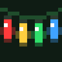

<p align="center">
  
</p>

<h1 align="center">Christmas Lights for VS Code 🎄</h1>

<p align="center">
  Hangs a string of pixel-art Christmas lights in your VS Code title bar. Every bulb pulses gently at its own pace, just like the real thing.
</p>

<p align="center">
  <a href="https://github.com/ric3-12/vscode-extension-christmaslights/issues/new?labels=bug&template=bug_report.md&title=">Report a Bug</a>
  ·
  <a href="https://github.com/ric3-12/vscode-extension-christmaslights/issues/new?labels=enhancement&template=feature_request.md&title=">Request feature</a>
</p>


## Table of Contents

- [Installation](#installation)
- [Using Christmas Lights](#using-christmas-lights)
- [Settings](#settings)
- [How it works](#how-it-works)
- [Deutsch](#deutsch)
- [Credits](#credits)
- [Thank you](#thank-you)

## Installation

Install this extension from the [VS Code Marketplace](https://marketplace.visualstudio.com/items?itemName=ric3.weihnachtslichter).

**OR**

With VS Code open, search for `Christmas Lights for VS Code` in the extension panel (`Ctrl+Shift+X` on Windows/Linux or `Cmd(⌘)+Shift+X` on macOS) and click install.

**OR**

With VS Code open, launch VS Code Quick Open (`Ctrl+P` on Windows/Linux or `Cmd(⌘)+P` on macOS), paste the following command, and press enter.

```
ext install ric3.weihnachtslichter
```

## Using Christmas Lights

Congrats on installing some Christmas spirit! After installing, open the command palette with `Ctrl+Shift+P` on Windows/Linux or `Cmd(⌘)+Shift+P` on macOS.

Run the **Christmas Lights: Turn On Christmas Lights** command (`weihnachtslichter.einschalten`) and reload the window to switch the lights on.

Some other things you can do:

| Command | What it does |
| --- | --- |
| **Turn On Christmas Lights** | Switch the lights on |
| **Turn Off Christmas Lights** | Switch the lights off |
| **Choose Position of Christmas Lights** | Hang the lights in the title bar, the status bar or on top of everything |

Commands, settings and messages are available in English and German and follow your VS Code display language.

Pair it with the matching color themes from [Cozy Christmas Theme](https://marketplace.visualstudio.com/items?itemName=ric3.weihnachten-theme) ([GitHub](https://github.com/ric3-12/vscode-weihnachten-theme)): Pine, Snow and Gingerbread.

## Settings

| Setting | Default | Description |
| --- | --- | --- |
| `weihnachtslichter.position` | `titelleiste` | `titelleiste` (title bar, behind the menu), `statusleiste` (status bar) or `ueberAllem` (on top of everything) |
| `weihnachtslichter.animation` | `sparsam` | `sparsam` (pulses in fine steps, much less CPU), `fluessig` (perfectly smooth, most CPU) or `aus` (steady glow, no CPU) |
| `weihnachtslichter.groesse` | `2` | Size of one pixel in screen pixels (1–4) |
| `weihnachtslichter.tempo` | `1` | Pulse speed (`0.5` = slower, `2` = faster) |
| `weihnachtslichter.abstandOben` | `0` | Only for `ueberAllem`: distance from the top edge in pixels |

If your system has *reduce motion* turned on, the lights glow steadily instead of pulsing.

### Performance

The wire and the switched-off bulbs are a still background image. Only the glow is animated, using CSS `opacity` on a few layers, which the GPU can handle without repainting the title bar. By default the bulbs dim in fine steps instead of 60 frames per second. When the VS Code window is in the background (title bar position), the animation pauses completely.

| Setup (measured in Chromium without GPU, 2500 px wide title bar) | CPU (one core) |
| --- | --- |
| Version 1.2 (animated SVG) | ~20 % |
| Version 1.3, `fluessig` | ~13 % |
| Version 1.3, `sparsam` (default) | ~7 % |
| Version 1.3, window in background or `aus` | 0 % |

With a GPU, the numbers in VS Code are lower.

## How it works

Extensions can't draw on the VS Code interface itself. So the command injects a small `<style>` block into VS Code's `workbench.html`. This is the same approach as extensions like «Custom CSS and JS Loader». It also updates the checksum in `product.json`, so VS Code doesn't complain about a corrupt installation.

- **After a VS Code update** the lights are gone. The extension asks whether to switch them on again.
- **On uninstall** the extension removes the injected block automatically (after the next VS Code restart). To remove the lights right away, run **Turn Off Christmas Lights**.
- If VS Code is installed for all users, you need admin rights once. Snap and Flatpak installs are not supported.
- If you still see «Your Code installation appears to be corrupt», restart VS Code completely. A window reload is not enough.

## Deutsch

Eine Pixel-Lichterkette in Rot, Gold, Grün und Blau für die Titelleiste von VS Code. Ist VS Code auf Deutsch eingestellt, erscheinen Befehle, Einstellungen und Meldungen auf Deutsch.

1. `Ctrl+Shift+P` → **Weihnachtslichter: Lichterkette einschalten**
2. **Fenster neu laden** klicken
3. Passende Farbschemas gibt es separat: [Cozy Christmas Theme](https://marketplace.visualstudio.com/items?itemName=ric3.weihnachten-theme)

Ausschalten mit **Lichterkette ausschalten**. Die Position (Titelleiste, Statusleiste oder über allem) wählst du mit **Position der Lichterkette wählen**.

## Credits

Pixel art and code by [ric3-12](https://github.com/ric3-12). **Has been Coded with Claude as an experiment**

## Thank you

Thanks to all the [contributors](https://github.com/ric3-12/vscode-extension-christmaslights/graphs/contributors) to this project. Frohe Weihnachten! 🎄
