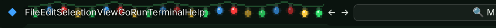

# Weihnachtslichter 🎄

Eine Pixel-Lichterkette in Rot, Gold, Grün und Blau am oberen Fensterrand. Jedes Lämpchen pulsiert in seinem eigenen Rhythmus, so wie eine echte Lichterkette. Dazu gibt es das Farbschema **Weihnachten Pixel**.

## Benutzung

1. `Ctrl+Shift+P` → **Weihnachtslichter: Lichterkette einschalten**
2. **Fenster neu laden** klicken (falls nichts erscheint: VS Code ganz neu starten)
3. Optional das Farbschema wählen: `Ctrl+K Ctrl+T` → **Weihnachten Pixel**

Ausschalten: **Weihnachtslichter: Lichterkette ausschalten**

## Einstellungen

| Einstellung | Standard | Bedeutung |
|---|---|---|
| `weihnachtslichter.position` | `titelleiste` | `titelleiste` (hinter Menü und Titel), `statusleiste` oder `ueberAllem` – auch per Befehl «Position der Lichterkette wählen» |
| `weihnachtslichter.groesse` | `2` | Pixelgrösse (1–4) |
| `weihnachtslichter.tempo` | `1` | Pulsier-Tempo |
| `weihnachtslichter.abstandOben` | `0` | Nur bei `ueberAllem`: Abstand vom oberen Rand |

## Wie es funktioniert

Eine Extension darf normalerweise nichts über die VS-Code-Oberfläche zeichnen. Deshalb fügt der Befehl einen `<style>`-Block in die `workbench.html` der VS-Code-Installation ein. Diese Methode verwenden auch Extensions wie «Custom CSS and JS Loader». Die Prüfsumme in `product.json` wird dabei mit angepasst, damit keine Meldung «Installation beschädigt» erscheint.

- Nach einem **VS-Code-Update** ist die Kette weg. Die Extension fragt dann, ob sie wieder eingeschaltet werden soll.
- Beim **Deinstallieren** räumt die Extension den Eintrag automatisch auf (nach dem nächsten Neustart von VS Code). Sofort weg ist die Kette mit «Lichterkette ausschalten».
- Wenn VS Code für alle Benutzer installiert ist, braucht es einmal Admin-Rechte. Snap- und Flatpak-Installationen funktionieren nicht.
- In der Titelleiste läuft die Kette hinter dem Menü (File, Edit …) durch und verschwindet hinter Suchfeld und Icons und leuchtet nur in den freien Bereichen.
- Ist im System «Bewegung reduzieren» aktiviert, leuchtet die Kette ruhig, ohne zu pulsieren.

---

## English

Pixel-art string lights in red, gold, green and blue for your VS Code title bar. Every bulb pulses gently at its own pace, like real Christmas lights. Includes the **Weihnachten Pixel** color theme.

**Usage:** `Ctrl+Shift+P` → **Weihnachtslichter: Lichterkette einschalten** (turn on) → reload the window. Turn off with **Lichterkette ausschalten**. Choose the position (title bar, status bar or on top of everything) with **Position der Lichterkette wählen**.

**How it works:** Extensions can't draw on the VS Code UI, so the command injects a `<style>` block into VS Code's `workbench.html` (the same approach as «Custom CSS and JS Loader») and updates the checksum in `product.json`. After a VS Code update you'll be asked to turn the lights on again. On uninstall the extension removes the injected block (after the next restart). If VS Code is installed for all users, you need admin rights once. Snap/Flatpak installs are not supported.
